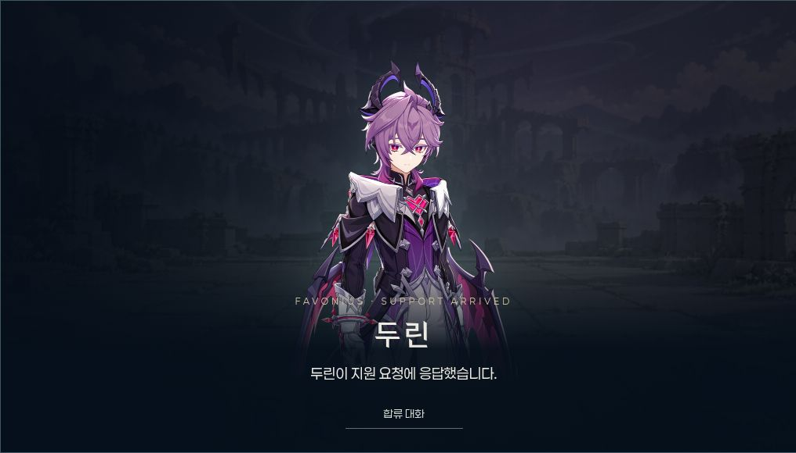
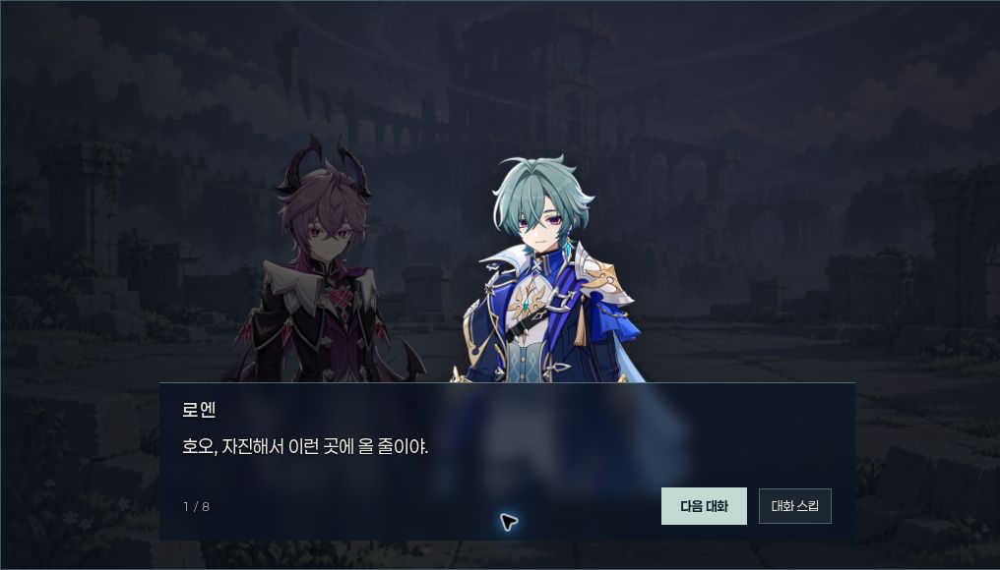
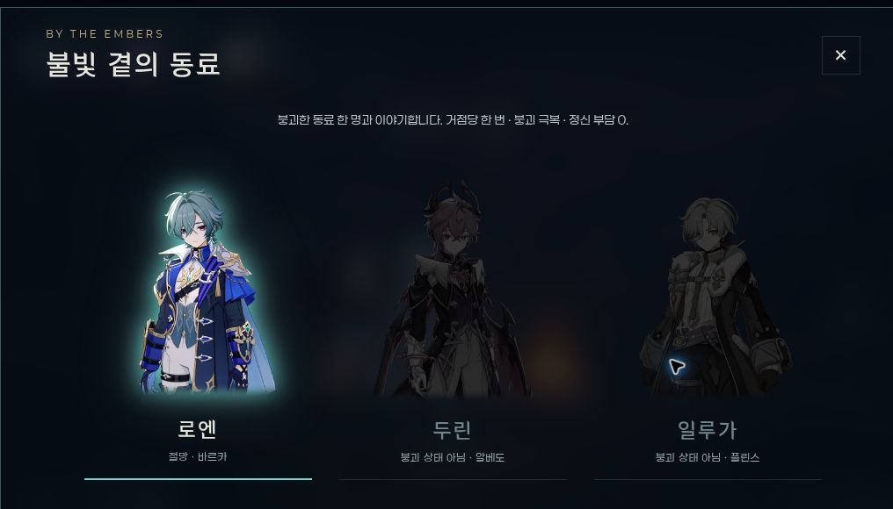
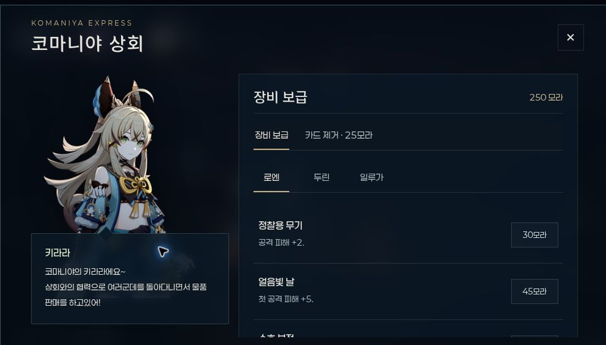
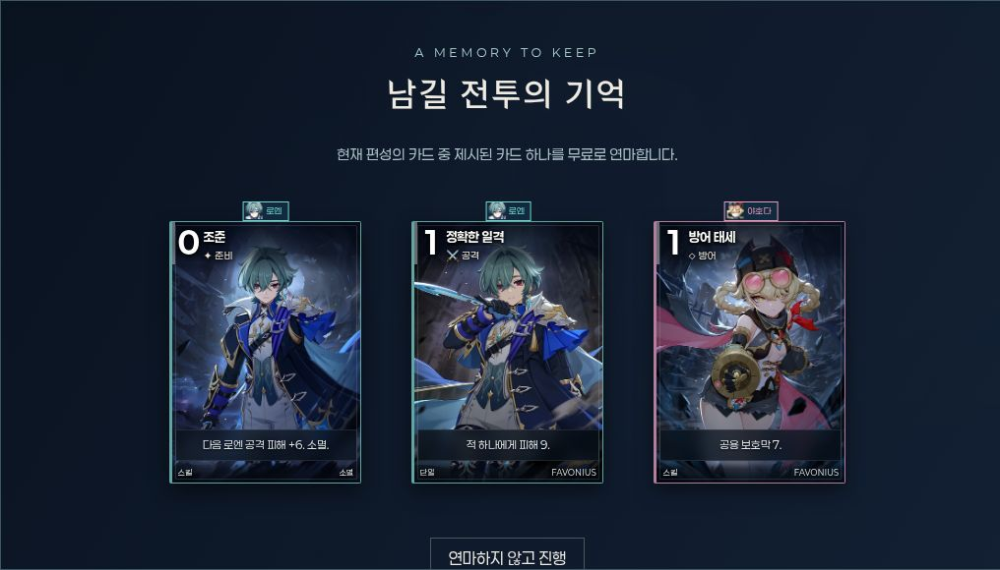
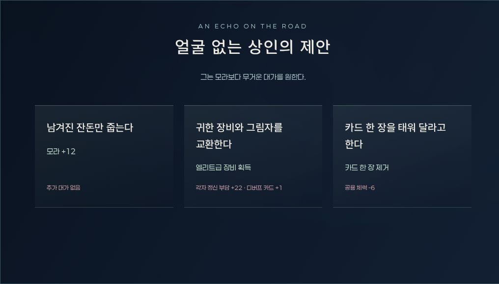

# 0.12 · 합류와 확장 원정

사용자가 제공한 대사를 `dist/story-scripts.js`에 그대로 보존했다. 말하는 인물, 스탠딩 전환과 동작 지시를 문장 밖에 둔다. 합류 23줄, 정신 안정 42줄, 총 65줄이다.

## 이야기 진행

조작 튜토리얼 → 바르카/로엔 대화 → 동료 선택 → 왼쪽에서 들어오는 스탠딩과 하단 합류 안내 → 합류 대화 → 다음 조작 튜토리얼 또는 첫 거점.

- 합류 선택 순간 파티에 등록되지만 다음 전투는 합류 대화가 끝난 후 시작한다. 도중의 도착 연출·대화 커서를 저장하고 복원한다.
- 조작 안내 스킵은 바르카 대화를 지우지 않는다. 대화창 스킵은 해당 대화만 건너뛴다.
- 두린 대화의 로엔 ‘… 잠깐.’에는 들썩임, 야호다 ‘우,’에는 들썩임, ‘우와아악!!!!!’에는 흔들림을 지정했다. 야호다 첫 대사에서는 로엔이 보이지 않으며 ‘안녕?’부터 등장한다.
- 정신 안정에서 일루가 마지막 줄, 두린 9번째 줄 이후, 야호다 마지막 줄에 기본 스탠딩을 사용한다. 말하지 않는 인물은 어둡게 표시한다.
- 이미 합류가 끝난 구버전 저장에는 새 합류 대화를 강제로 재생하지 않는다. 구버전의 미확인 합류 안내도 확인 후 진행할 수 있다.

## 정신 안정

거점에서만, 현재 편성 중 붕괴한 한 명만 선택할 수 있다. 대화를 끝내면 그 한 명의 붕괴가 해제되고 정신 부담이 0이 된다. 거점 전체에서 한 번 사용한다. 취소한 대화는 횟수를 쓰지 않는다.

사용 횟수는 체크포인트·재시작·저장에 보존되며, 반복 탐사로 같은 거점에 돌아와도 갱신되지 않는다. 새로운 거점에 도착하면 새 기회가 주어진다. 불꽃은 기존대로 신체 회복, HP +20, 출전원 부담 -5이며 붕괴를 해제하지 않는다. 야영의 부담 감소 역시 붕괴 자체를 해제하지 않는다.

선택 화면은 배경을 어둡게 흐리고 스탠딩을 직접 표시한다. 선택 가능 인물도 선택 전에는 어둡고, 마우스/키보드 강조에서 발광한다. 상점도 같은 배경 위에 키라라와 말풍선, 오른쪽 구매 영역으로 구성한다. 제거 목록에는 카드 아래의 별도 텍스트를 표시하지 않는다.

## 연마와 전리품

확률은 `dist/expedition-content.js`의 `LOOT_RULES`에 모았다. 초기 조정값이다.

| 기회 | 장비 | 연마 | 비고 |
| --- | --- | --- | --- |
| 일반전 승리 | 25% | 15% | 일반급 장비만 |
| 정예·보스 승리 | 확정 | 55% | 장비 중 25%는 엘리트급 |
| 새 거점·야영 도착 | 해당 없음 | 35% | 기회가 있을 때만 연마 버튼 표시 |

- 모라와 전투 경험은 기존의 가벼운 성장 구조를 유지한다. 정예는 모라 +12 추가. 전투 보상은 수령 전까지 지급되지 않으며 넘어가면 장비·연마도 받지 않는다.
- 연마는 현재 편성에서 보유하고 아직 강화하지 않은 카드 종류를 섞어 최대 세 종류 제시한다. 후보가 부족하면 가능한 것만 표시한다. 하나를 고른 뒤 A/B 방향 중 하나로 무료 연마하고 기회를 소모한다. 기존의 상시 20모라 연마는 없앴다.
- 후보와 전리품을 저장하므로 창 재열기·새로고침으로 다시 뽑을 수 없다. 소비한 후보를 다시 사용할 수 없다. 편성에서 빠진 인물의 후보는 사용할 수 없고, 편성 변경으로 후보를 새로 뽑지 않는다.
- 장비는 보유 목록에 들어가고, 상점에서 현재 편성원에게 비용 없이 장착할 수 있다. 남은 수량을 추적해 한 개를 여러 명에게 복제 장착하지 못한다. 기존 구매 장비는 저장을 불러올 때 보유 목록에도 반영한다.
- 엘리트 장비는 잔불의 창(공격 +4, 첫 공격 추가 +4), 여명의 인장(시작 보호막 9, 정신 피해 15% 감소). 상점에서 공짜로 살 수 없다.

## 사건과 전선

기본 원정 지점을 8개에서 24개로 늘렸다. 새 16개 지점은 일반전 4, 사건 3, 정예 4, 야영 2, 거점 3으로 구성하고 일부 지점에는 우회 경로가 있다. 마지막 전초기지 뒤에 기존 악몽 영주 → 영역 수호자 → 파수꾼·타락의 3보스 전선을 잇는다. 반복 탐사는 출발한 거점으로 돌아온다.

사건은 네 종류 중 무작위로 등장한다. 각 사건의 선택지는 세 개이며, 모라·장비·카드 한 장 제거·세 후보 중 카드 연마의 네 혜택을 제공한다. 이득과 함께 공용 HP 감소, 각자 정신 부담 증가, 디버프 카드 추가를 미리 표시한다. 엘리트 장비나 많은 모라를 얻는 선택지는 복수의 대가를 지닌다.

디버프 카드 ‘악몽의 잔향’은 실제 덱에 추가되는 1코스트 무효·소멸 카드다. 붕괴나 실명으로 유익한 카드가 되지 않는다. 전투·저장·카드 제거에서 실제 한 장으로 추적한다. 연마 가능한 카드가 없는 사건 연마 보상은 15모라로 대체한다.

새 몬스터 이미지 14개는 계속 레퍼런스로만 보존하며 게임에 적용하지 않았다.

## 검증과 화면

93개 검사 통과. 세 가지 파티가 정상 액션만 사용해 확장 16지점과 최종 전선을 통과하는 경로, 합류 6편성 순서, 사용 횟수/후보/전리품 저장, 사건 전체 선택지, 장비 복제 방지를 포함한다. 실제 화면 검증의 범위는 QA.md의 0.12 항목에 구분했다. 사람의 직접 플레이와 Android 실기기의 장기 성능·밸런스 검증은 별도다.

테스트·피드백 페이지에는 28개 장면이 있다. 합류 연출/대화, 붕괴 상태 거점, 세 카드 연마, 정예 전리품과 연마, 사건 카드 제거, 정예전, 확장 거점 등을 바로 불러올 수 있다.

