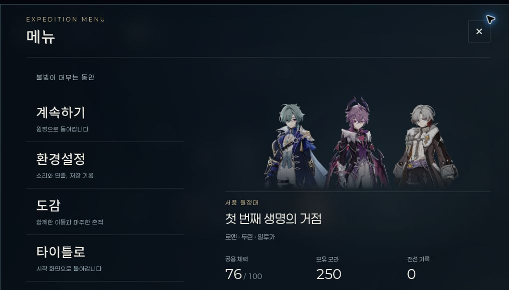
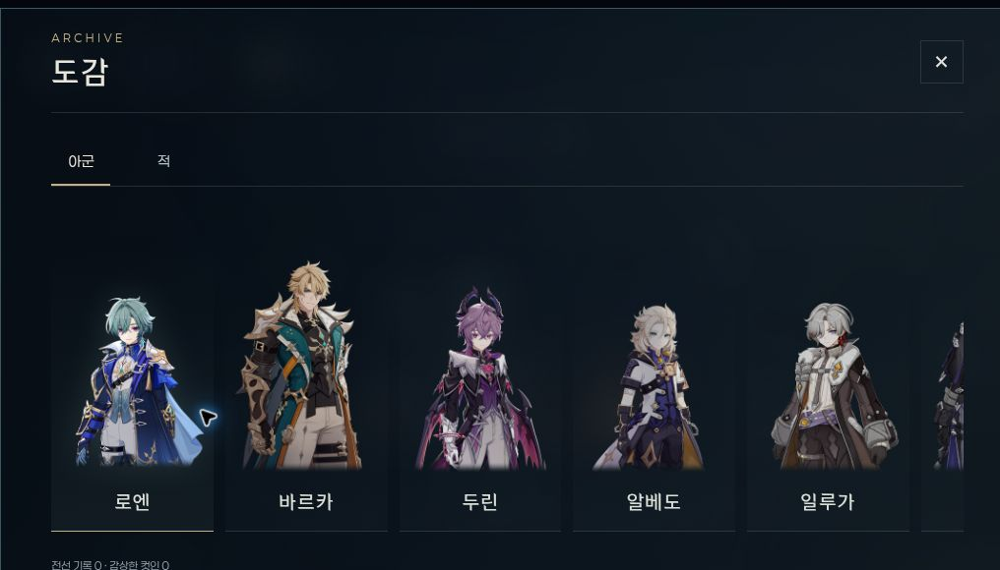
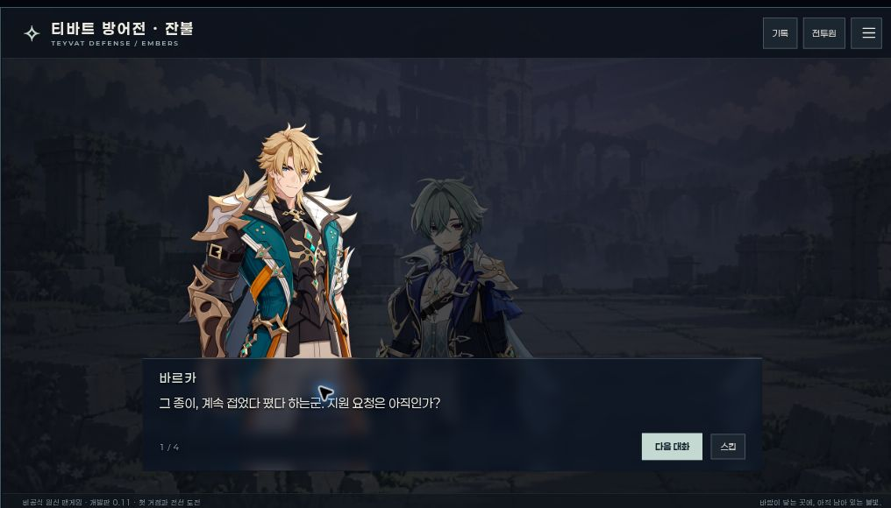

# 0.11 · 메뉴와 도감의 공통 디자인

잔불의 타이틀에 맞춰 청흑색 반투명 화면, 아이보리 글자, 절제된 금색과 청록색, 얇은 구분선을 공통으로 사용한다. 두꺼운 그라데이션 팝업 프레임을 없애고 게임 화면 위에 펼쳐지는 전체 화면 구조로 바꿨다. 짧은 확인 안내만 작은 중앙 화면을 사용한다. 스탠딩·카드·배경 원본과 전투 규칙은 그대로 사용한다.

## 참고한 화면

- NieR:Automata SYSTEM 화면의 왼쪽 행동 목록과 오른쪽 상태 정보 분리. [SYSTEM 화면 이미지](https://images.squarespace-cdn.com/content/v1/52a99e60e4b0a32c1362f41d/1735414289120-IW53283ULLIZPQ0Y59EE/Nier%2BAutomata%2BUI.png), [게임 화면 자료](https://www.gamepressure.com/nier-automata/saving-to-save-the-game/z6ea88).
- 리버스: 1999의 설정 분류, 여백과 얇은 구분선. [CBT 화면이 실린 글](https://note.com/taiun/n/nf72867f3f082), [참고 설정 화면](https://assets.st-note.com/img/1692333665466-Pm6Mk5fyp9.png?fit=bounds&height=2000&quality=85&width=2000).

참고 이미지는 실제로 열어 배치를 확인했다. 해당 게임의 UI 이미지·아이콘·텍스처는 런타임에 복사하지 않았다.

## 적용

| 화면 | 변경 |
| --- | --- |
| 메뉴 | 세로 행동 목록, 파티 스탠딩과 현재 지역·체력·모라·전선 기록 |
| 환경설정 | 소리 / 연출 / 저장·안내를 실제로 전환하는 분류, 음량 수치와 간결한 토글 |
| 도감 | 상자 없이 이어진 스탠딩 진열, 얇은 아군/적 탭, 이미지 중심 상세와 펼침 일러스트 목록 |
| 상태·상점·편성·연마·원정 기록·안내 | 같은 제목·닫기·글꼴·탭·행 구분선. 카드 이미지와 부상 도식 및 하단 전투원 선택 유지 |
| 정신 안정 대화 | 전체 화면 캐릭터와 기존 대화 배치 유지, 공용 프레임으로 둘러싸지 않음 |

제목은 LevelUp, 본문은 Paperlogy. 키보드 포커스는 열린 창 안에 유지되고, 배경 전투 조작은 비활성화한다. 닫으면 이전 버튼으로 돌아간다. 동작 줄이기 설정도 적용한다.

## 스킵 구분

- `skipTutorial`: 조작 전투 중에만 가능. 해당 영입 장면의 `recruitLine=0`으로 이동해 바르카 대화를 표시한다. 체력·모라·캐릭터 성장·RNG를 바꾸지 않는다.
- `skipRecruitDialogue`: 영입 대화 중에만 가능. 플레이어가 대화창의 스킵을 직접 누른 경우에만 선택지로 이동한다.
- 대화 커서는 저장·복원된다. 이미 대화를 마친 구버전 저장은 강제로 되돌리지 않는다.
- QA의 두 영입 선택 장면은 명시적 대화 스킵을 사용한다. 첫 지원 요청 대화 / 두 번째 지원 요청 대화 장면을 추가해 대화부터 바로 확인할 수도 있다.

## 실제 화면

